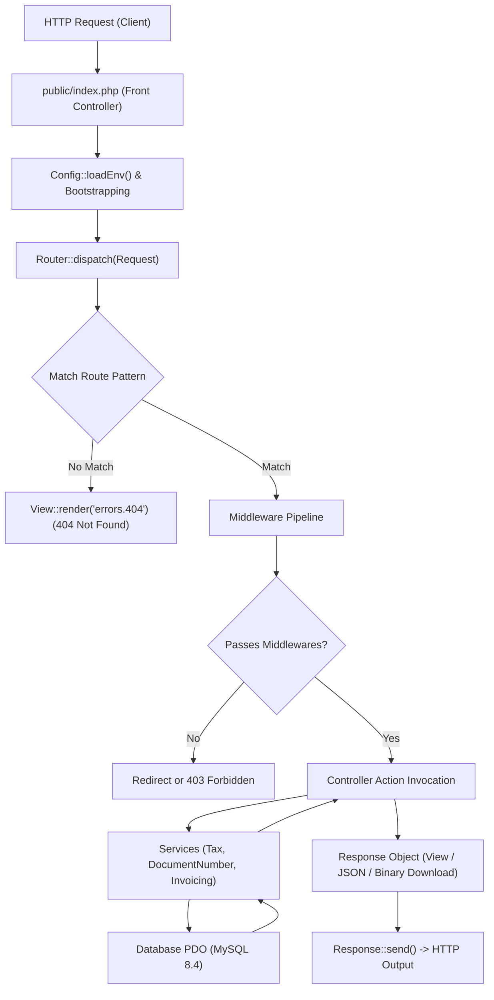

# Architectural Design & Lifecycle

## 1. Architectural Philosophy
ToolLab Invoice is engineered as a clean, performant, enterprise-grade PHP application without heavyweight framework bloat. It adheres to:
- **Separation of Concerns**: Controllers handle request orchestration; Services encapsulate business arithmetic; Views render presentation; Support classes encapsulate infrastructure.
- **Strict Multi-Tenant Isolation**: Every financial entity (customers, items, sequences, invoices, estimates, payments, audit logs) is scoped strictly to a `business_id`.
- **Zero Node.js Runtime Requirement**: Assets are compiled down to clean, optimized vanilla CSS and ES6+ JavaScript, requiring no live Node server or background watchers.
- **Concurrency Safety**: High-concurrency financial operations (sequence allocation, balance adjustments) use InnoDB row-level locking (`SELECT ... FOR UPDATE`) within ACID transactions.

---

## 2. Request Lifecycle



### Step-by-Step Execution:
1. **Front Controller**: All requests route through `public/index.php` via Apache `mod_rewrite` (`.htaccess`).
2. **Environment & Helper Bootstrapping**: `.env` is parsed into memory; helper functions (`url()`, `asset()`, `e()`, `format_currency()`, `format_date()`) are declared.
3. **Route Matching**: `Router::dispatch()` matches the HTTP method and URI pattern (supporting dynamic parameters like `{id}`).
4. **Middleware Execution**:
   - `GuestMiddleware`: Redirects authenticated sessions away from login/register to dashboard.
   - `AuthMiddleware`: Verifies valid user and active business in session; redirects unauthenticated visitors to `/login`.
   - `CsrfMiddleware`: Intercepts mutating requests (`POST`), verifying the `_csrf_token` session hash with `hash_equals()`.
5. **Controller & Service Layer**: Controllers instantiate and invoke domain services for calculations, sequence generation, or PDF/Export rendering.
6. **Response Transmission**: Standardized `Response` object sets HTTP status codes, headers (e.g. `Content-Type: application/pdf`, `Content-Disposition`), and flushes output.

---

## 3. Directory Structure

```
toollab-invoice/
├── app/
│   ├── Controllers/             # HTTP Controllers (Auth, Dashboard, Invoice, etc.)
│   ├── Middleware/              # HTTP Middlewares (Auth, Guest, Csrf)
│   ├── Services/                # Pure Domain Logic
│   │   ├── AuditService.php             # System activity and compliance audit trail
│   │   ├── DocumentNumberService.php    # Concurrency-safe FY sequence generation
│   │   ├── ExportService.php            # RFC-4180 CSV & SpreadsheetML Excel generator
│   │   ├── InvoiceCalculationService.php# Line items, discounts, rounding math
│   │   ├── PdfService.php               # Dompdf vector PDF wrapper
│   │   └── TaxCalculationService.php    # Intra-state vs Inter-state GST rules
│   ├── Support/                 # Core Infrastructure Layer
│   │   ├── Config.php           # Environment and config loader
│   │   ├── Csrf.php             # Cryptographic CSRF token manager
│   │   ├── Currency.php         # Indian Rupee formatting (Lakhs, Crores)
│   │   ├── Database.php         # PDO singleton with transaction wrappers
│   │   ├── FinancialYear.php    # April-to-March FY detection (e.g. 24-25)
│   │   ├── NumberToWords.php    # Rupee to words translator
│   │   ├── Request.php          # Request wrapper for GET, POST, headers, files
│   │   ├── Response.php         # Standardized HTTP response sender
│   │   ├── Router.php           # Fast regex-based HTTP router
│   │   ├── Session.php          # Encapsulated session management with flash messaging
│   │   └── View.php             # PHP templating engine with layouts and components
│   └── Views/                   # Templates
│       ├── auth/                # Login, Register, Forgot Password
│       ├── components/          # Sidebar, Navbar, Alerts, Pagination
│       ├── customers/           # Directory, profile, ledger
│       ├── dashboard/           # Metrics, charts, recent activities
│       ├── estimates/           # Quotation create, edit, show, print, pdf
│       ├── invoices/            # Tax invoice create, edit, show, print, pdf
│       ├── layouts/             # App master layout and Auth layout
│       ├── payments/            # Receipt vouchers, allocations, print, pdf
│       ├── products/            # Catalog, HSN/SAC, pricing
│       ├── recurring/           # Subscription profiles and occurrences
│       ├── reports/             # Sales, GSTR-1, Ageing, Ledger, Tax liability
│       ├── settings/            # Business, GST, Sequences, Tax Rates, Account
│       └── errors/              # 404, 500 error templates
├── bin/                         # CLI Automation Commands
├── config/                      # Configuration arrays
├── database/                    # schema.sql and seeders
└── public/                      # Webroot assets and front controller
```

---

## 4. Multi-Tenant Account Isolation Model

ToolLab Invoice implements logical data isolation via business ownership:

1. **User Membership**: Users belong to one or more businesses via the `business_members` join table, carrying explicit roles (`owner`, `admin`, `accountant`, `viewer`).
2. **Session Context**: Upon authentication, the active `business_id` is locked into the session state (`$_SESSION['business']`).
3. **Scoped Queries**: Every database query in all controllers and services includes a mandatory `WHERE business_id = ?` clause.
4. **Cross-Tenant Prevention**: Even if an ID is tampered with in a URL parameter (e.g., `/invoices/105`), the query `SELECT * FROM invoices WHERE id = ? AND business_id = ?` will fail to return a record, redirecting with a "Record Not Found" error.

---

## 5. Domain Service Architecture

| Service | Purpose & Implementation |
|---|---|
| `DocumentNumberService` | Uses `SELECT current_number FROM document_sequences WHERE ... FOR UPDATE` within a transaction to guarantee non-repeating serial numbers even during concurrent invoice creation. |
| `TaxCalculationService` | Analyzes 2-digit state codes of supplier vs customer. Intra-state applies equal split of CGST and SGST; Inter-state applies 100% IGST. |
| `InvoiceCalculationService` | Distributes invoice-level flat or percentage discounts across line items proportionally to compute exact net taxable value before tax calculation. |
| `ExportService` | Generates RFC-4180 CSV with UTF-8 BOM (`\xEF\xBB\xBF`) for instant Excel compatibility without messy encoding prompts, and native Microsoft XML SpreadsheetML (`.xls`) with typed cells (`Number` vs `String`), bold header styles, and formula sanitization. |
| `PdfService` | Configures Dompdf with sandboxed chroot, Unicode character mapping, and renders pixel-perfect vector A4 invoices, quotations, and vouchers. |
