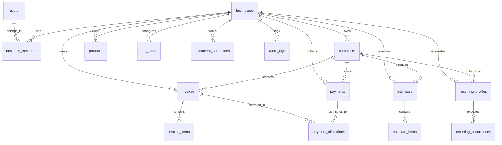

# Database Architecture & Schema Specification

## 1. Schema Overview

ToolLab Invoice is built upon MySQL 8.4+ InnoDB with strict foreign key constraints, `utf8mb4_unicode_ci` collation, and optimized compound indexes for financial queries.



---

## 2. Table Specifications (17 Tables)

### Authentication & Multi-Tenancy
1. **`users`**: User identity, hashed passwords (`PASSWORD_DEFAULT`), avatar, and timestamps.
2. **`businesses`**: Organization profile, trade name, legal entity name, GSTIN, PAN, state code, address, bank credentials, and document prefixes.
3. **`business_members`**: Organization multi-tenancy mapping linking users to businesses with explicit roles (`owner`, `admin`, `accountant`, `viewer`).
4. **`password_resets`**: Cryptographic password reset tokens with 60-minute expiry timestamps.

### Master Catalogs
5. **`customers`**: Customer directory, contact persons, billing address, shipping address, GSTIN, PAN, Place of Supply state code, currency, and credit limits.
6. **`products`**: Goods and services catalog, item type (`goods` | `service`), HSN/SAC code, selling price, purchase price, default GST rate ID, unit of measurement.
7. **`tax_rates`**: Configured GST slabs (0%, 5%, 12%, 18%, 28%) and custom tax exemptions.

### Document Sequences & Financial Documents
8. **`document_sequences`**: Sequence counter for each financial year and document type (`invoice`, `estimate`, `payment`). Holds row-level locks during generation.
9. **`invoices`**: Main invoice master: invoice number, issue date, due date, customer snapshot, place of supply, taxable value, CGST, SGST, IGST, total amount, paid amount, balance due, and status (`draft`, `issued`, `partially_paid`, `paid`, `void`).
10. **`invoice_items`**: Line items for each invoice: product snapshot, HSN/SAC, quantity, unit price, line discount, pro-rated discount, taxable value, GST rate %, CGST, SGST, IGST, and line total.
11. **`estimates`**: Quotation / estimate master: estimate number, expiry date, status (`draft`, `sent`, `accepted`, `declined`, `converted`, `expired`), converted invoice ID.
12. **`estimate_items`**: Line items for each quotation.

### Automation & Subscriptions
13. **`recurring_profiles`**: Automated billing profiles: frequency (`monthly`, `quarterly`, `semi_annually`, `annually`), start date, end date, next issue date, max cycles, cycles completed, auto-send flag, line items JSON snapshot.
14. **`recurring_occurrences`**: Execution history of recurring profiles, linking each cycle to the generated invoice ID.

### Cash Flow & Collections
15. **`payments`**: Payment receipt vouchers: receipt number, payment date, customer ID, amount, allocated amount, unallocated credit, payment method (`upi`, `neft`, `rtgs`, `net_banking`, `card`, `cheque`, `cash`), reference/UTR number, bank deposited, status (`posted`, `reversed`), reversal reason.
16. **`payment_allocations`**: Join entity recording how a payment receipt was partitioned across one or more open invoices.

### Compliance & Auditing
17. **`audit_logs`**: Tamper-evident activity trail: actor user ID, business ID, action event (e.g. `invoice.created`, `payment.reversed`, `report.exported`), entity type, entity ID, metadata JSON, IP address, and user agent.

---

## 3. Sequence Allocation & Concurrency Logic

To guarantee that invoice numbers never collide or skip numbers under high-concurrency conditions, `DocumentNumberService` executes the following atomic pattern:

```sql
START TRANSACTION;

-- Lock the sequence row specifically for this business, type, and financial year
SELECT current_number 
FROM document_sequences 
WHERE business_id = 1 AND document_type = 'invoice' AND financial_year = '24-25' 
FOR UPDATE;

-- Increment counter
UPDATE document_sequences 
SET current_number = current_number + 1, updated_at = NOW() 
WHERE business_id = 1 AND document_type = 'invoice' AND financial_year = '24-25';

COMMIT;
```

If no row exists for the newly entered Financial Year (e.g. April 1st), the service inserts a starting row with `current_number = 1`.

---

## 4. Key Indexes for High-Performance Queries

| Table | Index Columns | Purpose |
|---|---|---|
| `invoices` | `(business_id, status)` | Fast dashboard KPIs and receivable filtering |
| `invoices` | `(business_id, issue_date)` | High-speed sales register and GSTR-1 date range reports |
| `invoices` | `(business_id, customer_id)` | Customer account ledger queries |
| `payments` | `(business_id, payment_date)` | Collections and cash flow reports |
| `payments` | `(business_id, customer_id)` | Customer receipts history |
| `payment_allocations` | `(payment_id)`, `(invoice_id)` | Rapid invoice balance verification and reversal joins |
| `recurring_profiles` | `(status, next_issue_date)` | Instant CLI cron selection of due recurring profiles |
| `audit_logs` | `(business_id, created_at)` | Fast audit trail inspection |
