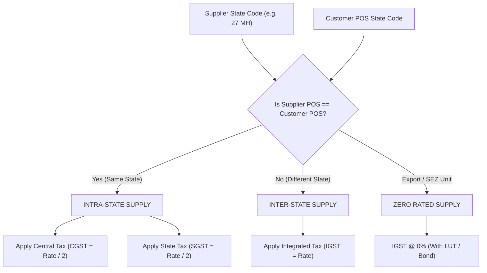

# Indian GST Compliance & Calculation Logic

## 1. Statutory Grounding (Rule 46 of CGST Rules, 2017)

Under Rule 46 of the Central Goods and Services Tax (CGST) Rules, 2017, every registered taxable person issuing a tax invoice must include specific statutory details:
1. Name, address, and GSTIN of the supplier.
2. A consecutive serial number not exceeding 16 characters, containing only letters, numerals, and special characters (`-`, `/`), unique for a Financial Year.
3. Date of its issue.
4. Name, address, and GSTIN or UIN (if registered) of the recipient.
5. Place of supply along with the name of the State and its 2-digit code (for inter-State supplies).
6. Harmonized System of Nomenclature (HSN) code for goods or Service Accounting Code (SAC) for services.
7. Description of goods or services.
8. Quantity in case of goods and unit or Unique Quantity Code (UQC).
9. Total value of supply of goods or services.
10. Taxable value of supply of goods or services considering discount or abatement.
11. Rate of tax (Central tax, State tax, Integrated tax, Cess).
12. Amount of tax charged in respect of taxable goods or services (CGST, SGST, IGST, Cess).
13. Whether the tax is payable on Reverse Charge basis.
14. Signature or digital signature of the supplier or authorized representative.

---

## 2. Tax Determination Algorithm

The system determines tax components by comparing the supplier's registration state code with the customer's Place of Supply (POS) state code:

### Formulae:
- **Intra-State Supply**:
  $$\text{CGST Amount} = \text{Taxable Value} \times \left(\frac{\text{GST Rate}}{200}\right)$$
  $$\text{SGST Amount} = \text{Taxable Value} \times \left(\frac{\text{GST Rate}}{200}\right)$$
  $$\text{IGST Amount} = 0.00$$

- **Inter-State Supply**:
  $$\text{CGST Amount} = 0.00$$
  $$\text{SGST Amount} = 0.00$$
  $$\text{IGST Amount} = \text{Taxable Value} \times \left(\frac{\text{GST Rate}}{100}\right)$$

---

## 3. Two-Digit GST State Codes

| Code | State / Union Territory | Code | State / Union Territory |
|---|---|---|---|
| **01** | Jammu & Kashmir | **19** | West Bengal |
| **02** | Himachal Pradesh | **20** | Jharkhand |
| **03** | Punjab | **21** | Odisha |
| **04** | Chandigarh | **22** | Chhattisgarh |
| **05** | Uttarakhand | **23** | Madhya Pradesh |
| **06** | Haryana | **24** | Gujarat |
| **07** | Delhi | **27** | Maharashtra |
| **08** | Rajasthan | **29** | Karnataka |
| **09** | Uttar Pradesh | **32** | Kerala |
| **10** | Bihar | **33** | Tamil Nadu |
| **12** | Arunachal Pradesh | **36** | Telangana |
| **18** | Assam | **37** | Andhra Pradesh |

---

## 4. Pro-Rated Invoice Discount Distribution Math

When an invoice carries an overarching discount (e.g. ₹5,000 flat discount or 10% on the entire invoice), GST law requires that discounts be attributed to each line item before computing line-level GST to ensure that tax liability is assessed strictly on the net realized consideration.

`InvoiceCalculationService` distributes invoice discounts proportionally:

1. **Calculate Base Subtotal after Line Discounts**:
   $$\text{Line Subtotal}_i = (\text{Quantity}_i \times \text{Unit Price}_i) - \text{Line Discount}_i$$
   $$\text{Total Base Subtotal} = \sum \text{Line Subtotal}_i$$

2. **Calculate Invoice-Level Discount Amount**:
   $$\text{Invoice Discount} = \begin{cases} 
   \text{Total Base Subtotal} \times \left(\frac{\text{Percent}}{100}\right) & \text{if percentage} \\
   \text{Flat Amount} & \text{if fixed}
   \end{cases}$$

3. **Pro-Rate to Line Item $i$**:
   $$\text{Pro-Rated Discount}_i = \text{Invoice Discount} \times \left(\frac{\text{Line Subtotal}_i}{\text{Total Base Subtotal}}\right)$$

4. **Compute Net Taxable Value**:
   $$\text{Taxable Value}_i = \text{Line Subtotal}_i - \text{Pro-Rated Discount}_i$$

5. **Calculate Tax on Net Base**:
   Taxes are computed strictly on $\text{Taxable Value}_i$, and rounded to 2 decimal places.

---

## 5. Composition Scheme & Bill of Supply

If a business selects **Composition Scheme** or **Unregistered Business** in Settings:
- The title of the document is generated as **BILL OF SUPPLY** instead of TAX INVOICE.
- The statutory declaration is rendered: *"Composition taxable person, not eligible to collect tax on supplies"*.
- Tax columns (CGST, SGST, IGST) are hidden or zeroed out, and the gross price represents the final billing value.
