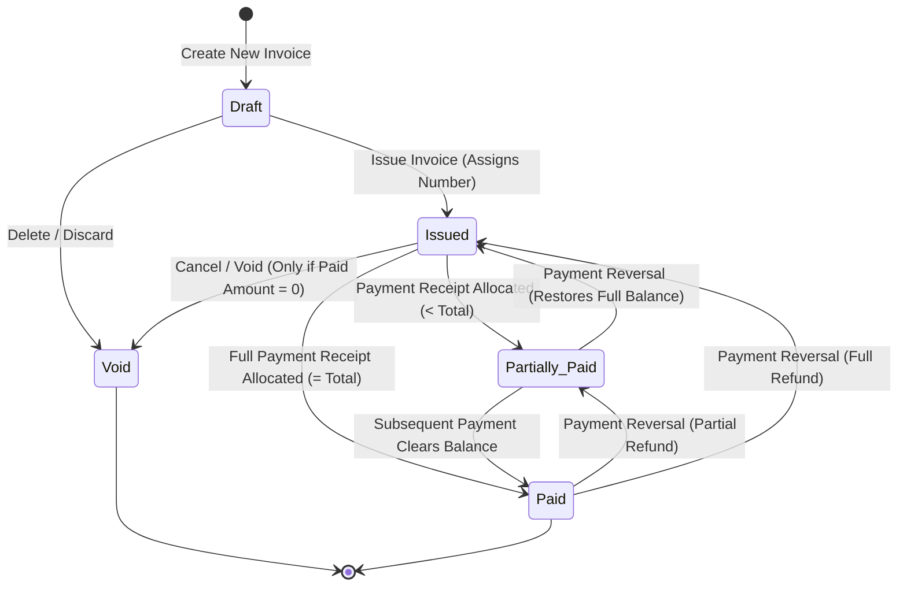

# Invoice Lifecycle & State Machine

## 1. State Machine Overview

An invoice in ToolLab Invoice moves through a deterministic, strictly validated lifecycle:

---

## 2. Status Definitions & Validation Rules

| Status | Permitted Operations | Financial Impact |
|---|---|---|
| **Draft** | Edit line items, change dates, change customer, delete completely. | Does not impact financial reports, receivables, or sales registers. Does not consume a document serial number. |
| **Issued** | Record payment, view, print, download PDF, duplicate, void. | Active accounts receivable. Counts in sales register and GSTR-1 output tax liability. Consumes permanent serial number. |
| **Partially Paid** | Record additional payments, view, print, download PDF. Cannot be edited or voided directly. | Reduces outstanding receivable while retaining active balance due. |
| **Paid** | View, print, download PDF. Cannot be edited or deleted. | Balance due = ₹0.00. Settled account. |
| **Void** | View only (audit reference). Cannot accept payments or be edited. | Excluded from sales register totals and GSTR-1 returns. Number remains consumed for audit continuity. |

---

## 3. Sequential Number Assignment

- Invoices saved as **Draft** are assigned a temporary internal draft state without consuming an official document sequence.
- When an invoice is **Issued**, `DocumentNumberService::generateNextNumber()` executes inside an atomic database transaction with row locks on `document_sequences`.
- This ensures zero gaps in GST sequence numbering, as mandated by Rule 46.

---

## 4. Estimates / Quotes Conversion Workflow

1. An estimate begins in `draft` status.
2. Once finalized, it transitions to `sent`, and upon customer approval, `accepted`.
3. Clicking **Convert to Invoice**:
   - Creates a new invoice record copying all line items, rates, quantities, discounts, and customer billing snapshot.
   - Assigns the next sequential Tax Invoice number for the current Financial Year.
   - Marks the estimate as `converted` and records the resulting `converted_invoice_id` for bidirectional traceability.
   - Logs `estimate.converted` in `audit_logs`.

---

## 5. Recurring Invoices Automation Engine

For recurring profiles (e.g. monthly retainers, annual maintenance contracts):
1. **Profile Setup**: A recurring profile specifies a customer, interval (`monthly`, `quarterly`, `semi_annually`, `annually`), start date, end date, payment terms, and items snapshot.
2. **Next Issue Calculation**: On creation, `next_issue_date` is initialized to the start date.
3. **Automated Batch Processing**:
   - The CLI runner (`bin/process-recurring-invoices.php`) queries active profiles where `next_issue_date <= CURRENT_DATE()`.
   - Generates an active `issued` Tax Invoice.
   - Records an entry in `recurring_occurrences`.
   - Increments `cycles_completed`.
   - Computes the subsequent `next_issue_date` based on the frequency.
   - If `end_date` is passed or `max_cycles` is met, marks profile as `completed`.
