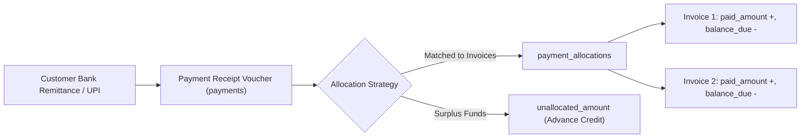

# Payment Receipts, Allocations & Reversals

## 1. Overview & Double-Entry Principles

ToolLab Invoice implements a professional payment receipt and invoice allocation engine. Payments and invoices are maintained as distinct financial entities linked via the `payment_allocations` join table.



---

## 2. Allocation Logic & Validations

When a payment receipt is recorded in `PaymentController::store()`:

1. **Receipt Header Recorded**:
   - Unique payment number generated (e.g. `PAY/24-25/0001`).
   - Payment method (`upi`, `neft`, `rtgs`, `net_banking`, `card`, `cheque`, `cash`).
   - Transaction reference / UTR number and depositing bank recorded.

2. **Allocations Validated**:
   - For every invoice submitted in the `allocations` array:
     $$\text{Allocated Amount} \le \text{Invoice Balance Due}$$
   - Sum of all allocated amounts must not exceed the received amount:
     $$\sum \text{Allocated Amounts} \le \text{Total Received Amount}$$

3. **Atomic Balance Updates**:
   Within a database transaction:
   ```sql
   INSERT INTO payment_allocations (payment_id, invoice_id, amount, created_at) VALUES (?, ?, ?, NOW());

   UPDATE invoices 
   SET paid_amount = paid_amount + ?,
       balance_due = total_amount - (paid_amount + ?),
       status = IF(balance_due <= 0, 'paid', 'partially_paid'),
       updated_at = NOW()
   WHERE id = ?;
   ```

4. **Unallocated Advance Credit**:
   If $\text{Received Amount} > \sum \text{Allocations}$, the difference is preserved in `unallocated_amount` as advance customer credit.

---

## 3. Auto-Allocation Algorithm

When the user clicks **Auto Allocate** on the receipt recording form:
1. The system sorts all open invoices for that customer chronologically by `due_date ASC`.
2. Iterates through the list, applying available unallocated funds to the oldest invoice first up to its outstanding balance.
3. Continues sequentially until the payment amount is fully exhausted.

---

## 4. Reversal Workflow & Audit Trail

In real-world business, cheques may bounce, duplicate transactions occur, or customers may pay into the wrong account. ToolLab Invoice provides an auditable, non-destructive reversal mechanism:

### Reversal Steps:
1. User clicks **Reverse Receipt** and supplies a mandatory statutory reason (e.g. *"Cheque bounced by bank"*).
2. Inside an atomic transaction:
   - Receipt status changes from `posted` to `reversed`.
   - `reversed_at`, `reversed_by_user_id`, and `reversal_reason` are stamped.
   - For each linked allocation in `payment_allocations`, the invoice's `paid_amount` is deducted and `balance_due` is restored.
   - The invoice status transitions backwards (`paid` $\to$ `partially_paid` $\to$ `issued`).
3. An audit event `payment.reversed` is recorded in `audit_logs` capturing the reversal reason and user credentials.
4. Receipts are never hard-deleted, preserving statutory voucher numbering and bank reconciliation integrity.
